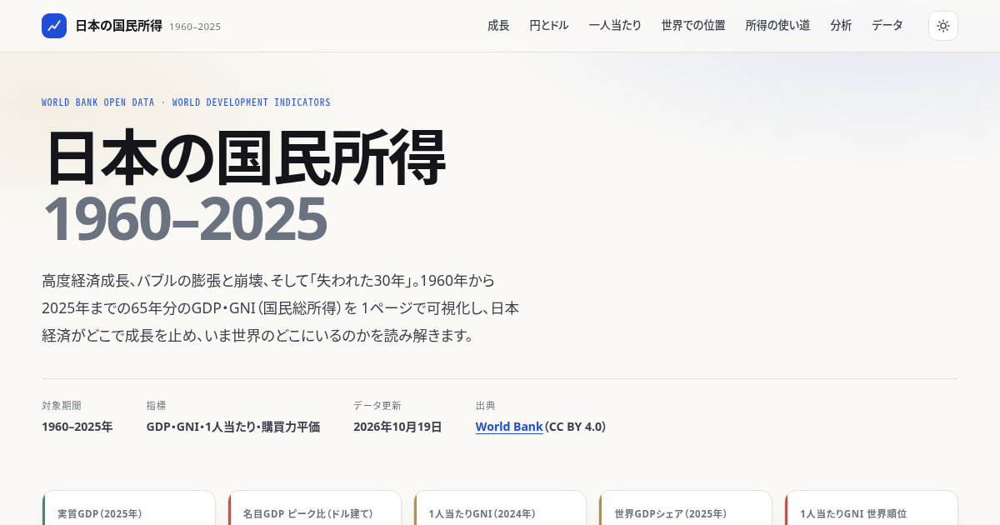

# 日本の国民所得 1960–2025

日本の GDP・GNI（国民総所得）の65年分の推移を可視化する、依存ライブラリを同梱した静的サイトです。
World Bank Open Data（World Development Indicators）から取得した公開データをもとに、成長の減速、
円建てとドル建ての乖離、1人当たりの豊かさ、世界での順位とシェアの変化を1ページで読み解きます。



## 収録している内容

| セクション | 内容 | 主な指標 |
| --- | --- | --- |
| 01 成長 | 実質GDPの対数軸チャートと、10年平均成長率 | `NY.GDP.MKTP.KD` |
| 02 円とドル | 名目GDPの円建て・ドル建て二軸チャート | `NY.GDP.MKTP.CD`, `PA.NUS.FCRF` |
| 03 一人当たり | 1人当たりGNI（為替換算／購買力平価）、対米比率 | `NY.GNP.PCAP.CD`, `NY.GNP.PCAP.PP.CD` |
| 04 世界での位置 | 世界GDPシェア、1人当たりGNIの世界順位、上位国表 | 全経済の `NY.GNP.PCAP.CD` |
| 05 所得の使い道 | 家計最終消費支出・総資本形成のGDP比 | `NE.CON.PRVT.ZS`, `NE.GDI.TOTL.ZS` |
| 06 分析 | データから自動生成する9つのファクト | 上記から計算 |
| 07 データ | 出典・注意点・年次データ表（CSV/JSON ダウンロード） | — |

グラフは Chart.js 4（`vendor/` に同梱）、ページは素の HTML/CSS/JS です。ビルド工程はありません。

## 構成

```
.
├── index.html              # ページ本体
├── assets/
│   ├── style.css           # スタイル（ライト/ダーク対応）
│   ├── app.js              # 可視化ロジック
│   └── og.png              # OGP 画像
├── data/
│   ├── data.json           # 生成データ（機械可読）
│   └── data.js             # 同じ内容を window 変数として読み込む版
├── scripts/
│   └── fetch_data.py       # データ取得・加工スクリプト（標準ライブラリのみ）
├── vendor/
│   └── chart.umd.min.js    # Chart.js 4.4.7
├── .github/workflows/pages.yml
├── .nojekyll
└── LICENSE
```

`data/data.js` を読み込むため、`file://` で直接開いても表示できます。

## データの再生成

```bash
python3 scripts/fetch_data.py
```

World Bank API から全指標を取得し、`data/data.json` と `data/data.js` を上書きします。
2回目以降は `data/cache/` の生レスポンスを使うため数秒で終わります。
`--no-cache` を付けると再取得します（`python3 scripts/fetch_data.py --no-cache`）。

## ローカルで確認

```bash
python3 -m http.server 8000
# http://127.0.0.1:8000/
```

## GitHub Pages で公開する

初回のみ、以下のどちらかを選びます。

**A. ブランチから配信（もっとも簡単）**

1. リポジトリの **Settings → Pages** を開く
2. *Build and deployment* の **Source** を `Deploy from a branch` にする
3. **Branch** を `main` / フォルダを `/ (root)` にして保存
4. 数十秒後、`https://<ユーザー名>.github.io/<リポジトリ名>/` で公開される

**B. GitHub Actions から配信**

`.github/workflows/pages.yml` を同梱しています。

1. **Settings → Pages** で **Source** を `GitHub Actions` にする
2. `main` に push すると自動でデプロイされる

CLI でまとめて行う場合:

```bash
gh repo create <リポジトリ名> --public --source=. --remote=origin --push
gh api -X POST "repos/{owner}/{repo}/pages" -f "source[branch]=main" -f "source[path]=/"
```

## データについて

- **出典**: World Bank Open Data — World Development Indicators（<https://data.worldbank.org/country/japan>）、ライセンスは [CC BY 4.0](https://creativecommons.org/licenses/by/4.0/)
- **GNI** は旧「国民所得」に対応する分配面の指標（GDP ＋ 海外からの純要素所得）
- **円建てGDPは参考値**: ドル建て名目GDPを期間平均為替レートで換算したもので、国民経済計算（SNA）の公表値とは一致しません
- **順位は比較可能な年のみ**: 報告国が少ない速報年は除外し、最新は2024年
- **購買力平価** は2021年基準の国際ドルで、国際比較プログラムの改定により水準が変わります

## ライセンス

- コード（HTML/CSS/JS/Python）: MIT License — [LICENSE](LICENSE)
- データ: CC BY 4.0（World Bank）
- Chart.js: MIT License

本サイトは公開データの可視化であり、投資その他の助言ではありません。数値は取得時点のもので、遡及改定により変わりえます。
